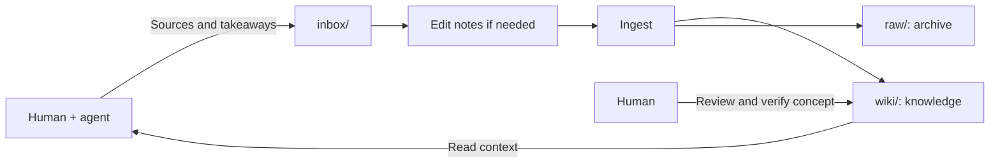

# LLM Wiki & Agent Memory Blueprint (Karpathy + OKF v0.2)

This repository is a ready-to-use **Blueprint** combining:

1. **Andrej Karpathy's LLM Wiki workflow** (Ingest, Query, Lint over plain Markdown files).
2. **Google's Open Knowledge Format (OKF v0.2)** (standardized YAML frontmatter, progressive disclosure via index.md, provenance via sources, and human-in-the-loop review via generated & verified).

Use it as a knowledge base and shared memory for human and AI agent sessions: agents read relevant context and capture durable decisions for later ingestion.

## Folders & Workflow

| Path | Purpose |
| --- | --- |
| [WIKI.md](./WIKI.md) | Agent rules; `AGENTS.md`, `CLAUDE.md`, and `GEMINI.md` point here. |
| [inbox/](./inbox/) | Pending sources and session notes that can be edited before ingest. |
| [raw/](./raw/) | Frozen source snapshots after ingestion. Existing files stay unchanged. |
| [assets/](./assets/) | Shared attachments for inbox notes, archived sources, and wiki concepts. |
| [wiki/](./wiki/) | The maintained wiki: OKF concepts, cross-links, `index.md`, and `log.md`. |
| [outputs/](./outputs/) | Optional Humand/Agent shared working files: session reports, drafts, and artifacts for shared review or editing. |
| [specs/](./specs/) | Offline references: [OKF](./specs/okf/SPEC.md) and [Karpathy's original gist](./specs/karpathy/llm-wiki.md). |

`outputs/` sits outside the ingest workflow. Files saved there stay there until you decide what to do with them.

Ingest creates or updates wiki concepts from the notes in `inbox/` and moves the source files unchanged into `raw/`. Notes and concepts use relative links to the same attachments in `assets/`. Wiki concepts link to the archived notes through `sources`.

## Session Capture

With the Agent rules in [WIKI.md](./WIKI.md), Agents automatically save important new decisions, context, and reusable lessons from a session as concise notes in `inbox/`. Ingest later turns those notes into wiki knowledge that future sessions can use. Capture is an implicit agent instruction and normally needs no extra prompt.

Session capture works where the agent loads these repository instructions. Other projects need an explicit connection to this wiki; this blueprint installs no global hooks or background jobs.

## Quick Start

1. On GitHub, choose [**Use this template → Create a new repository**](https://docs.github.com/en/repositories/creating-and-managing-repositories/creating-a-repository-from-a-template), then clone your new repository. Alternatively, unzip the blueprint and initialize it with `git init`, `git add .`, and `git commit -m "chore: init llm-wiki"`.
2. **Optional setup.** Open your agent in the repository root and adapt this prompt to your use case.

   > Read WIKI.md first. I'm setting up a [personal wiki / private work wiki / shared team wiki] for [purpose and audience]. I'd like it to cover topics such as [examples]. Tailor WIKI.md and the agent instruction files to this use case.

3. Put 1–3 notes or sources into `inbox/`. For `inbox/YYYY-MM-DD-topic.md`, put attachments in `assets/YYYY-MM-DD-topic/` and link them as `../assets/YYYY-MM-DD-topic/image.png`.
4. Open your preferred agent harness in the repository root and prompt:

   > Read WIKI.md, then ingest the files in inbox/ into wiki/, archive the original sources in raw/, and summarize the concepts you created or updated.

## Useful Prompts

| Operation | Prompt |
| --- | --- |
| Capture* | Save the durable decisions and new context from this session into inbox/ according to WIKI.md. |
| Query | Answer [question] from the wiki, starting at wiki/index.md. Cite the relevant pages and consult raw/ for exact details. |
| Lint / OKF review | Read WIKI.md and specs/okf/SPEC.md. Audit the wiki's structure, frontmatter, sources, links, freshness, and pending inputs. Save a report in outputs/; propose reorganizations. |
| Human verification | I reviewed wiki/[page].md. Mark it verified by human:[name] and log that review. |

\* Capture is already an agent rule and needs no separate skill or explicit prompt. This prompt is an optional reminder.
